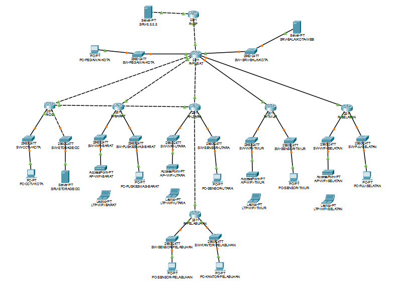

# Project-ETS-Jarkom-K7

## Identitas Kelompok

* **Muhammad Yusuf** - 5027251067
* **D'Qhaizhar Ari Dhiaulhaq** - 5027251083
* **Syarifah Nailatur Rohma** - 502251109

---

## Pembagian Tugas Kelompok

| Nama | NRP | Tugas |
| :--- | :--- | :--- |
| Muhammad Yusuf | 5027251067 | Membuat topologi dengan menerapkan dan mengkonfigurasikan subneting hasil hitungan dengan metode CIDR ke dalam topologi CIDR statis dan CIDR OSPF. |
| D'Qhaizhar Ari Dhiaulhaq | 5027251083 | Menghitung dan membagi penggunaan IP berdasarkan host yang dibutuhkan menggunakan metode CIDR dan VLSM sesuai metode kelas, serta melakukan testing pada hasil topologi CIDR & VLSM buatan Yusuf dan Naila. |
| Syarifah Nailatur Rohma | 502251109 | Membuat topologi dengan menerapkan dan mengkonfigurasikan subneting hasil hitungan dengan metode VLSM ke dalam topologi VLSM statis dan VLSM OSPF. |

---

## 1. Pendahuluan & Alasan Pemilihan Skema (CIDR vs VLSM)

Dalam perancangan infrastruktur jaringan skala besar untuk area perkotaan dan publik, efisiensi penggunaan alamat IP ($IPv4$) sangat krusial agar tidak terjadi pemborosan alamat (address exhaustion). 

* **Metode VLSM (Variable Length Subnet Mask):** Dipilih untuk topologi utama karena memungkinkan alokasi subnet yang dinamis berdasarkan besar kecilnya kebutuhan host pada setiap segmen (misal: WiFi Publik membutuhkan 11.000 host, sementara Server Balai Kota hanya butuh 20 host). Hal ini menekan persentase host terbuang secara signifikan.
* **Metode CIDR (Classless Inter-Domain Routing) / Fixed Block:** Digunakan sebagai pembanding atau pada struktur area tertentu yang membutuhkan pembagian blok seragam demi kesederhanaan administrasi routing, meskipun memiliki efisiensi alokasi host yang lebih rendah.

### Tabel Perbandingan Efisiensi Alokasi Host

| Teknik Subnetting | Alokasi Host Digunakan (%) | Host Tidak Digunakan / Terbuang (%) |
| :--- | :---: | :---: |
| **VLSM** | 46.96% | 53.04% |
| **CIDR** | 36.56% | 63.44% |

---

## 2. Desain Topologi Jaringan

Topologi dirancang menggunakan simulator jaringan (Cisco Packet Tracer / GNS3 / EVE-NG) yang mencakup router core pusat (`R-PUSAT`), router penghubung ISP (`R-ISP`), serta router cabang regional (`R-UTARA`, `R-BARAT`, `R-TIMUR`, `R-SELATAN`, `R-PELABUHAN`, dan `R-DC`).

```
          [ Server SRV-8.8.8.8 ]
                  |
              [ R-ISP ]
                  |
             [ R-PUSAT ] <--- (Terhubung ke Router Cabang via OSPF / Static)
              /   |   \
    [R-UTARA] [R-BARAT] [R-TIMUR] ...
```





*Gambar 1.1: Desain Topologi Keseluruhan Jaringan Perkotaan.*

---

## 3. Penjelasan Subnetting & Konfigurasi

### A. Tabel Subnetting VLSM
Berikut adalah cuplikan alokasi subnet menggunakan VLSM:
* **WiFi Publik Utara:** Kebutuhan 11.000 host, Prefix `/18` (Total IP: 16.384, Usable: 16.382), Network ID: `10.56.0.0`, Gateway: `10.56.0.1`.
* **Kantor Pelabuhan:** Kebutuhan 120 host, Prefix `/25` (Total IP: 128, Usable: 126), Network ID: `10.56.240.0`, Gateway: `10.56.240.1`.


*Gambar 3.1: Tabel Alokasi Subnet VLSM.*

### B. Tabel Subnetting CIDR
* **WiFi Publik Utara:** Prefix `/18`, Network ID: `10.56.0.0`, Gateway: `10.56.0.1`.
* **Link Point-to-Point (R-PUSAT - R-UTARA):** Prefix `/30`, Network ID: `10.56.66.0`, Usable IP: 2.


*Gambar 3.2: Tabel Alokasi Subnet CIDR.*

---

## 4. Konfigurasi Routing (Statis & OSPF)

Konfigurasi routing dilakukan pada masing-masing router untuk memastikan komunikasi antar-LAN berjalan lancar.

### Contoh Konfigurasi OSPF pada R-PUSAT:
```text
Router(config)# router ospf 1
Router(config-router)# network 10.56.0.0 0.0.63.255 area 0
Router(config-router)# network 10.57.0.0 0.0.63.255 area 0
```


*Gambar 4.1: Konfirmasi Tabel Routing dan OSPF Neighbor.*

---

## 5. Bukti Pengujian Mandiri (Testing & Verification)

Pengujian dilakukan secara langsung meliputi pengujian konektivitas dasar, failover OSPF, NAT, Tunneling GRE, hingga akses layanan aplikasi (DNS, Web, FTP).

### 1. Pengujian Konektivitas & Ping Antar-LAN
Melakukan tes ping dari komputer Balai Kota ke Pelabuhan dan server publik luar (`8.8.8.8`).


*Gambar 5.1: Hasil Ping sukses dari PC Pegawai Kota ke Server Publik dan Cabang.*

### 2. Pengujian Failover OSPF & Jalur Cadangan
Memutuskan link utama secara sengaja untuk menguji peralihan jalur otomatis (failover) melalui routing OSPF.


*Gambar 5.2: Log pengujian failover saat link utama terputus.*

### 3. Pengujian Layanan Aplikasi (DNS & Web Server)
Mengakses web server internal menggunakan nama domain serta pengujian DNS lookup (`nslookup`).


*Gambar 5.3: Akses Web Server dan verifikasi DNS.*

---

## 6. Penutup & Kesimpulan

Proyek perancangan jaringan ini berhasil diimplementasikan dengan baik menggunakan metode VLSM dan CIDR. Berdasarkan perbandingan efisiensi, metode **VLSM** terbukti jauh lebih optimal dalam menghemat alokasi IP dibandingkan CIDR murni. Seluruh layanan jaringan, routing statis, OSPF, DHCP, NAT, serta Tunneling GRE telah diuji dan berfungsi secara optimal sesuai kebutuhan skenario perkotaan.