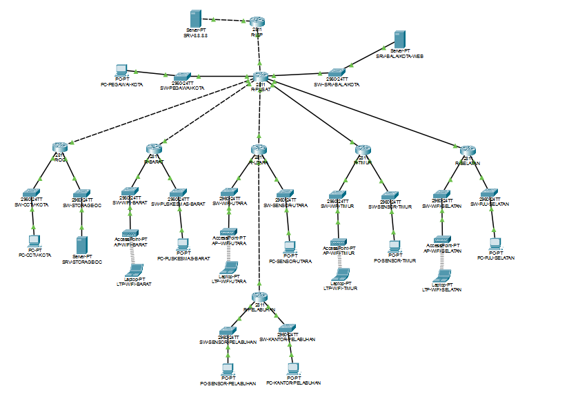
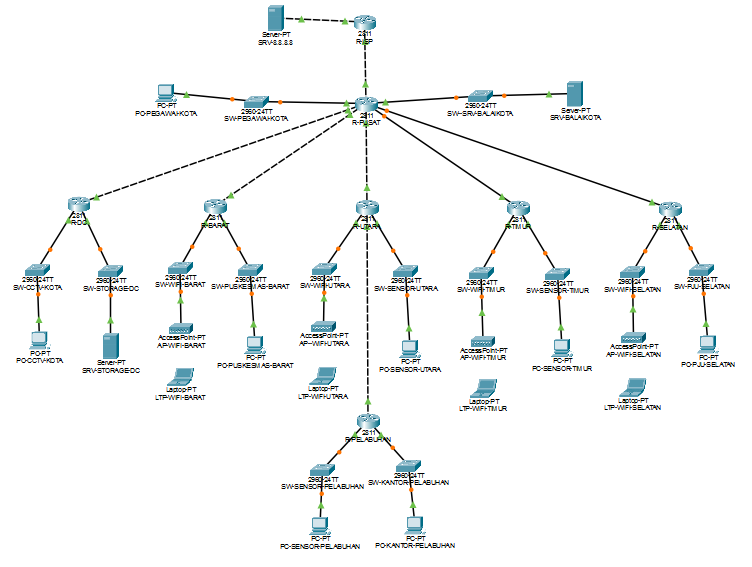
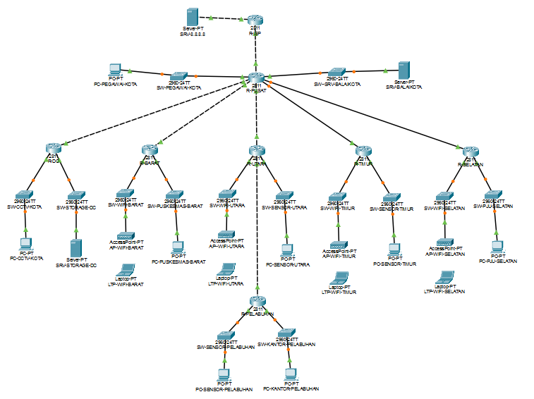
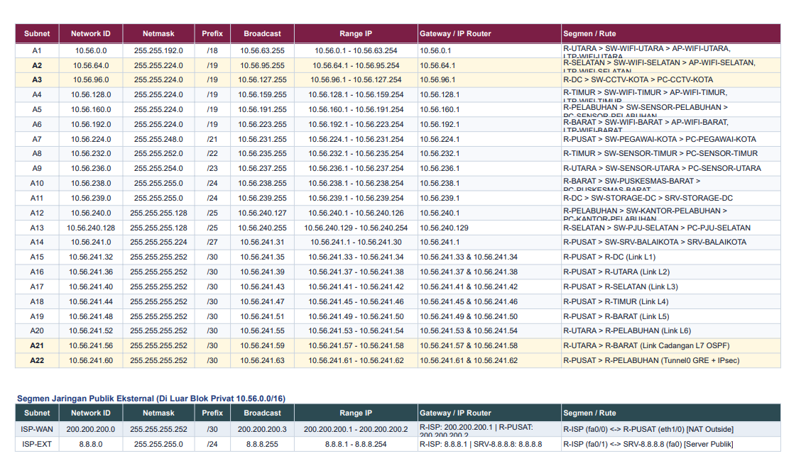
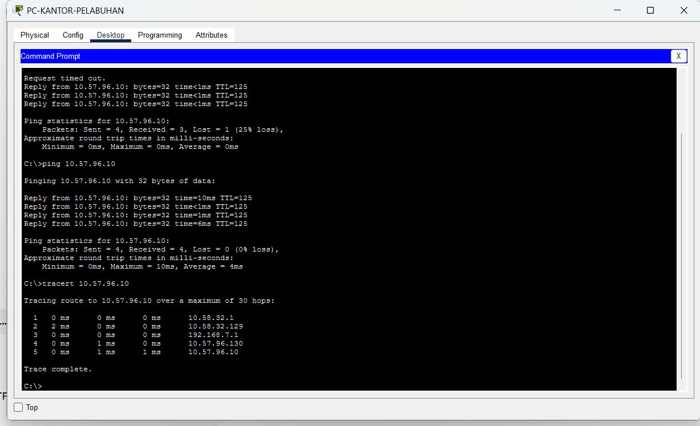

# Project-ETS-Jarkom-K7

## Identitas Kelompok

* **Muhammad Yusuf** - 5027251067
* **D'Qhaizhar Ari Dhiaulhaq** - 5027251083
* **Syarifah Nailatur Rohma** - 502251109

---

## Pembagian Tugas Kelompok

| Nama | NRP | Tugas |
| :--- | :--- | :--- |
| Muhammad Yusuf | 5027251067 | Membuat topologi dengan menerapkan dan mengkonfigurasikan subneting hasil hitungan dengan metode CIDR ke dalam topologi CIDR statis dan CIDR OSPF. |
| D'Qhaizhar Ari Dhiaulhaq | 5027251083 | Menghitung dan membagi penggunaan IP berdasarkan host yang dibutuhkan menggunakan metode CIDR dan VLSM sesuai metode kelas, serta melakukan testing pada hasil topologi CIDR & VLSM buatan Yusuf dan Naila. |
| Syarifah Nailatur Rohma | 502251109 | Membuat topologi dengan menerapkan dan mengkonfigurasikan subneting hasil hitungan dengan metode VLSM ke dalam topologi VLSM statis dan VLSM OSPF. |

---

## 1. Pendahuluan & Alasan Pemilihan Skema (CIDR vs VLSM)

Dalam perancangan infrastruktur jaringan skala besar untuk area perkotaan dan publik, efisiensi penggunaan alamat IP ($IPv4$) sangat krusial agar tidak terjadi pemborosan alamat (address exhaustion). 

* **Metode VLSM (Variable Length Subnet Mask):** Dipilih untuk topologi utama karena memungkinkan alokasi subnet yang dinamis berdasarkan besar kecilnya kebutuhan host pada setiap segmen (misal: WiFi Publik membutuhkan 11.000 host, sementara Server Balai Kota hanya butuh 20 host). Hal ini menekan persentase host terbuang secara signifikan.
* **Metode CIDR (Classless Inter-Domain Routing) / Fixed Block:** Digunakan sebagai pembanding atau pada struktur area tertentu yang membutuhkan pembagian blok seragam demi kesederhanaan administrasi routing, meskipun memiliki efisiensi alokasi host yang lebih rendah.

### Tabel Perbandingan Efisiensi Alokasi Host

| Teknik Subnetting | Alokasi Host Digunakan (%) | Host Tidak Digunakan / Terbuang (%) |
| :--- | :---: | :---: |
| **VLSM** | 46.96% | 53.04% |
| **CIDR** | 36.56% | 63.44% |

---

## 2. Desain Topologi Jaringan

Topologi dirancang menggunakan simulator jaringan (Cisco Packet Tracer / GNS3 / EVE-NG) yang mencakup router core pusat (`R-PUSAT`), router penghubung ISP (`R-ISP`), serta router cabang regional (`R-UTARA`, `R-BARAT`, `R-TIMUR`, `R-SELATAN`, `R-PELABUHAN`, dan `R-DC`).

```
          [ Server SRV-8.8.8.8 ]
                  |
              [ R-ISP ]
                  |
             [ R-PUSAT ] <--- (Terhubung ke Router Cabang via OSPF / Static)
              /   |   \
    [R-UTARA] [R-BARAT] [R-TIMUR] ...
```





*Gambar 1.1: Desain Topologi Keseluruhan Jaringan Perkotaan.*

---

## 3. Penjelasan Subnetting & Konfigurasi

### A. Tabel Subnetting VLSM
Berikut adalah cuplikan alokasi subnet menggunakan VLSM:
* **WiFi Publik Utara:** Kebutuhan 11.000 host, Prefix `/18` (Total IP: 16.384, Usable: 16.382), Network ID: `10.56.0.0`, Gateway: `10.56.0.1`.
* **Kantor Pelabuhan:** Kebutuhan 120 host, Prefix `/25` (Total IP: 128, Usable: 126), Network ID: `10.56.240.0`, Gateway: `10.56.240.1`.


*Gambar 3.1: Tabel Alokasi Subnet VLSM.*

### B. Tabel Subnetting CIDR
* **WiFi Publik Utara:** Prefix `/18`, Network ID: `10.56.0.0`, Gateway: `10.56.0.1`.
* **Link Point-to-Point (R-PUSAT - R-UTARA):** Prefix `/30`, Network ID: `10.56.66.0`, Usable IP: 2.


*Gambar 3.2: Tabel Alokasi Subnet CIDR.*

---

## 4. Konfigurasi Routing (Statis & OSPF)

Konfigurasi routing dilakukan pada masing-masing router untuk memastikan komunikasi antar-LAN berjalan lancar.

### Contoh Konfigurasi OSPF pada R-PUSAT:
```text
Router(config)# router ospf 1
Router(config-router)# network 10.56.0.0 0.0.63.255 area 0
Router(config-router)# network 10.57.0.0 0.0.63.255 area 0
```


*Gambar 4.1: Konfirmasi Tabel Routing dan OSPF Neighbor.*

---

## 5. Bukti Pengujian Mandiri (Testing & Verification)

Pengujian dilakukan secara langsung meliputi pengujian konektivitas dasar, failover OSPF, NAT, Tunneling GRE, hingga akses layanan aplikasi (DNS, Web, FTP).

### 1. Pengujian Konektivitas & Ping Antar-LAN
Melakukan tes ping dari komputer Balai Kota ke Pelabuhan dan server publik luar (`8.8.8.8`).


*Gambar 5.1: Hasil Ping sukses dari PC Pegawai Kota ke Server Publik dan Cabang.*

### 2. Pengujian Failover OSPF & Jalur Cadangan
Memutuskan link utama secara sengaja untuk menguji peralihan jalur otomatis (failover) melalui routing OSPF.


*Gambar 5.2: Log pengujian failover saat link utama terputus.*

### 3. Pengujian Layanan Aplikasi (DNS & Web Server)
Mengakses web server internal menggunakan nama domain serta pengujian DNS lookup (`nslookup`).


*Gambar 5.3: Akses Web Server dan verifikasi DNS.*

---

## 6. Penutup & Kesimpulan

Proyek perancangan jaringan ini berhasil diimplementasikan dengan baik menggunakan metode VLSM dan CIDR. Berdasarkan perbandingan efisiensi, metode **VLSM** terbukti jauh lebih optimal dalam menghemat alokasi IP dibandingkan CIDR murni. Seluruh layanan jaringan, routing statis, OSPF, DHCP, NAT, serta Tunneling GRE telah diuji dan berfungsi secara optimal sesuai kebutuhan skenario perkotaan.

## Implementasi CIDR, VLAN, Layanan Server, Static Routing, OSPF, NAT, GRE, dan Wireless pada Cisco Packet Tracer

---

## 1. Pendahuluan

Proyek jaringan **Smart City Surabaya** merupakan simulasi perancangan jaringan komputer terintegrasi menggunakan Cisco Packet Tracer yang menghubungkan wilayah Balai Kota, Data Center, Utara, Barat, Timur, Selatan, Pelabuhan, serta simulasi jaringan eksternal (ISP/Internet).

Perancangan jaringan menerapkan metode **CIDR (Classless Inter-Domain Routing)** untuk efisiensi alokasi alamat IP sesuai kebutuhan host, segmentasi logis menggunakan **VLAN**, penyediaan layanan terpusat (**DHCP, DNS, FTP, Web, dan Email Server**), konektivitas nirkabel (**Access Point**), translasi alamat (**NAT Overload**), terowongan virtual (**GRE Tunnel**), serta perbandingan dua skenario routing: **Static Routing** dan **Dynamic Routing (OSPF)** lengkap dengan pengujian redundansi (*failover*).

---

## 2. Topologi dan Perangkat Jaringan

Perangkat utama yang digunakan dalam simulasi meliputi **Router Cisco 2811**, **Switch Cisco 2960**, **Server-PT**, **AccessPoint-PT**, serta **PC-PT / Laptop-PT** sebagai perangkat klien.

### 2.1 Spesifikasi Router dan Modul Tambahan

| Router | Wilayah / Fungsi | Modul Tambahan | Keterangan Interface |
|---|---|---|---|
| **R-PUSAT** | Balai Kota & Penghubung Utama | `NM-4E`, `HWIC-4ESW` | Menambah port routed Ethernet & switchport VLAN |
| **R-DC** | Data Center | `NM-1FE-TX` | Penghubung server & CCTV |
| **R-UTARA** | Wilayah Utara | `NM-2FE2W` | Penghubung LAN Utara, Pelabuhan (L6), & Cadangan DC (L7) |
| **R-BARAT** | Wilayah Barat | `NM-1FE-TX` | Penghubung LAN Barat |
| **R-TIMUR** | Wilayah Timur | `NM-1FE-TX` | Penghubung LAN Timur |
| **R-SELATAN** | Wilayah Selatan | `NM-1FE-TX` | Penghubung LAN Selatan |
| **R-PELABUHAN** | Wilayah Pelabuhan | `NM-1FE-TX` | Penghubung LAN Pelabuhan |
| **R-ISP** | Simulasi ISP | - | Penghubung jaringan internal ke Internet Server |

---

## 3. Perencanaan IP Address (CIDR) & Konfigurasi Interface

### 3.1 Alokasi IP Address Jaringan LAN

| No. | Jaringan | Network ID | Prefix | Subnet Mask | Gateway |
|---:|---|---|---|---|---|
| 1 | WiFi Publik Utara | `10.56.0.0` | `/18` | `255.255.192.0` | `10.56.0.1` |
| 2 | Sensor Lalu Lintas Utara | `10.56.64.0` | `/23` | `255.255.254.0` | `10.56.64.1` |
| 3 | CCTV Kota | `10.56.128.0` | `/19` | `255.255.224.0` | `10.56.128.1` |
| 4 | Server & Storage DC | `10.56.160.0` | `/24` | `255.255.255.0` | `10.56.160.1` |
| 5 | WiFi Publik Barat | `10.56.192.0` | `/19` | `255.255.224.0` | `10.56.192.1` |
| 6 | Puskesmas & Sekolah Barat | `10.56.224.0` | `/24` | `255.255.255.0` | `10.56.224.1` |
| 7 | WiFi Publik Timur | `10.57.0.0` | `/19` | `255.255.224.0` | `10.57.0.1` |
| 8 | Sensor Banjir Timur | `10.57.32.0` | `/22` | `255.255.252.0` | `10.57.32.1` |
| 9 | WiFi Publik Selatan | `10.57.64.0` | `/19` | `255.255.224.0` | `10.57.64.1` |
| 10 | PJU Pintu Selatan | `10.57.96.0` | `/25` | `255.255.255.128` | `10.57.96.1` |
| 11 | Pegawai Balai Kota | `10.57.128.0` | `/21` | `255.255.248.0` | `10.57.128.1` |
| 12 | Server Balai Kota | `10.57.136.0` | `/27` | `255.255.255.224` | `10.57.136.1` |
| 13 | SCADA Pelabuhan | `10.58.0.0` | `/19` | `255.255.224.0` | `10.58.0.1` |
| 14 | Kantor Pelabuhan | `10.58.32.0` | `/25` | `255.255.255.128` | `10.58.32.1` |

### 3.2 Alokasi IP Address Point-to-Point Antar-Router, ISP, dan GRE (`/30`)

| Link | Perangkat 1 (Interface & IP) | Perangkat 2 (Interface & IP) | Network (`/30`) | Keterangan |
|---|---|---|---|---|
| **L1** | R-PUSAT (`Eth1/1`: `10.56.161.1`) | R-DC (`Fa0/0`: `10.56.161.2`) | `10.56.161.0/30` | Backbone Utama DC |
| **L2** | R-PUSAT (`Eth1/3`: `10.56.66.1`) | R-UTARA (`Fa0/0`: `10.56.66.2`) | `10.56.66.0/30` | Backbone Utama Utara |
| **L3** | R-PUSAT (`VLAN 103`: `10.57.96.129`) | R-SELATAN (`Fa0/0`: `10.57.96.130`) | `10.57.96.128/30` | Backbone Selatan via SVI |
| **L4** | R-PUSAT (`VLAN 104`: `10.57.36.1`) | R-TIMUR (`Fa0/0`: `10.57.36.2`) | `10.57.36.0/30` | Backbone Timur via SVI |
| **L5** | R-PUSAT (`Eth1/2`: `10.56.225.1`) | R-BARAT (`Fa0/0`: `10.56.225.2`) | `10.56.225.0/30` | Backbone Barat |
| **L6** | R-UTARA (`Fa1/0`: `10.58.32.129`) | R-PELABUHAN (`Fa0/0`: `10.58.32.130`) | `10.58.32.128/30` | Backbone Pelabuhan via Utara |
| **L7** | R-DC (`Fa1/1`: `10.59.0.1`) | R-UTARA (`Eth1/2`: `10.59.0.2`) | `10.59.0.0/30` | Link Cadangan (Skenario OSPF) |
| **ISP** | R-PUSAT (`Eth1/0`: `203.0.113.29`) | R-ISP (`Fa0/0`: `203.0.113.30`) | `203.0.113.28/30` | Koneksi Eksternal / Publik |
| **GRE** | R-PUSAT (`Tunnel0`: `192.168.7.1`) | R-PELABUHAN (`Tunnel0`: `192.168.7.2`) | `192.168.7.0/30` | Tunnel Virtual Balai Kota–Pelabuhan |

### 3.3 Pemetaan Interface LAN Router

* **R-PUSAT:** `Fa0/0` (`10.57.128.1/21` - Pegawai BK), `Fa0/1` (`10.57.136.1/27` - Server BK).
* **R-DC:** `Fa0/1` (`10.56.128.1/19` - CCTV Kota), `Fa1/0` (`10.56.160.1/24` - Server & Storage DC).
* **R-BARAT:** `Fa0/1` (`10.56.192.1/19` - WiFi Barat), `Fa1/0` (`10.56.224.1/24` - Puskesmas & Sekolah).
* **R-UTARA:** `Fa0/1` (`10.56.0.1/18` - WiFi Utara), `Fa1/1` (`10.56.64.1/23` - Sensor Lalu Lintas).
* **R-TIMUR:** `Fa0/1` (`10.57.0.1/19` - WiFi Timur), `Fa1/0` (`10.57.32.1/22` - Sensor Banjir).
* **R-SELATAN:** `Fa0/1` (`10.57.64.1/19` - WiFi Selatan), `Fa1/0` (`10.57.96.1/25` - PJU Selatan).
* **R-PELABUHAN:** `Fa0/1` (`10.58.0.1/19` - SCADA Pelabuhan), `Fa1/0` (`10.58.32.1/25` - Kantor Pelabuhan).
* **R-ISP:** `Fa0/1` (`8.8.8.1/24` terhubung ke Internet Server `8.8.8.8/24`, gateway `8.8.8.1`).

---

## 4. Konfigurasi VLAN pada R-PUSAT

Karena modul `HWIC-4ESW` pada R-PUSAT menyediakan port switch Layer 2, koneksi point-to-point menuju **R-SELATAN** dan **R-TIMUR** dipisahkan secara logis menggunakan VLAN dan SVI (*Switched Virtual Interface*), sementara port `Fa0/1/2` dan `Fa0/1/3` dibiarkan tidak terpakai.

| VLAN ID | Nama VLAN | Port Access | IP Address SVI | Tujuan | Status Verifikasi |
|---:|---|---|---|---|---|
| **103** | `LINK-R-SELATAN` | `Fa0/1/1` | `10.57.96.129/30` | Koneksi R-SELATAN | Active (`up/up`) |
| **104** | `LINK-R-TIMUR` | `Fa0/1/0` | `10.57.36.1/30` | Koneksi R-TIMUR | Active (`up/up`) |

```cisco
! Pembuatan VLAN via VLAN Database
vlan database
 vlan 103 name LINK-R-SELATAN
 vlan 104 name LINK-R-TIMUR
exit

! Konfigurasi Switchport & SVI
interface fa0/1/1
 switchport mode access
 switchport access vlan 103
 no shutdown
interface fa0/1/0
 switchport mode access
 switchport access vlan 104
 no shutdown

interface vlan 103
 ip address 10.57.96.129 255.255.255.252
 no shutdown
interface vlan 104
 ip address 10.57.36.1 255.255.255.252
 no shutdown
```

---

## 5. Konfigurasi Layanan Server dan Access Point

### 5.1 Spesifikasi dan Pembagian Fungsi Server

Seluruh server internal mengarahkan DNS Server ke `10.56.160.2`.

| Nama Server | Lokasi LAN | IP Address / Prefix | Gateway | Layanan & Fungsi |
|---|---|---|---|---|
| **Server & Storage DC** | R-DC | `10.56.160.2/24` | `10.56.160.1` | **DHCP** (IP otomatis), **DNS** (resolusi domain), **FTP** (penyimpanan file/CCTV) |
| **Web Server** | Balai Kota | `10.57.136.2/27` | `10.57.136.1` | **HTTP/HTTPS** (Portal Smart City Surabaya) |
| **Mail Server** | Balai Kota | `10.57.136.3/27` | `10.57.136.1` | **SMTP/POP3** (Komunikasi email internal) |
| **Internet Server** | Luar R-ISP | `8.8.8.8/24` | `8.8.8.1` | **HTTP** (Simulasi layanan jaringan luar/internet) |

### 5.2 Konfigurasi DHCP Server dan DHCP Relay

Layanan DHCP diaktifkan pada **Server & Storage DC** (`10.56.160.2`) dengan konfigurasi 14 pool (Start IP dimulai dari oktet `.10` pada setiap subnet untuk menyisakan ruang IP statis perangkat jaringan, serta seluruh pool menggunakan DNS `10.56.160.2`):

| Pool Name | Default Gateway | Start IP | Subnet Mask | Max Users |
|---|---|---|---|---:|
| `SERVER-DC` | `10.56.160.1` | `10.56.160.10` | `255.255.255.0` | 180 |
| `CCTV-KOTA` | `10.56.128.1` | `10.56.128.10` | `255.255.224.0` | 6000 |
| `WIFI-UTARA` | `10.56.0.1` | `10.56.0.10` | `255.255.192.0` | 11000 |
| `SENSOR-UTARA` | `10.56.64.1` | `10.56.64.10` | `255.255.254.0` | 450 |
| `WIFI-BARAT` | `10.56.192.1` | `10.56.192.10` | `255.255.224.0` | 4500 |
| `PUSKESMAS-BARAT` | `10.56.224.1` | `10.56.224.10` | `255.255.255.0` | 220 |
| `WIFI-TIMUR` | `10.57.0.1` | `10.57.0.10` | `255.255.224.0` | 5500 |
| `SENSOR-BANJIR` | `10.57.32.1` | `10.57.32.10` | `255.255.252.0` | 700 |
| `WIFI-SELATAN` | `10.57.64.1` | `10.57.64.10` | `255.255.224.0` | 6500 |
| `PJU-SELATAN` | `10.57.96.1` | `10.57.96.10` | `255.255.255.128` | 90 |
| `PEGAWAI-BK` | `10.57.128.1` | `10.57.128.10` | `255.255.248.0` | 1800 |
| `SERVER-BK` | `10.57.136.1` | `10.57.136.10` | `255.255.255.224` | 20 |
| `SCADA-PELABUHAN` | `10.58.0.1` | `10.58.0.10` | `255.255.224.0` | 5000 |
| `KANTOR-PELABUHAN` | `10.58.32.1` | `10.58.32.10` | `255.255.255.128` | 120 |

**DHCP Relay:** Karena DHCP Server terpusat di Data Center, seluruh interface router yang menghadap ke LAN klien (kecuali LAN Server & Storage DC itu sendiri dan interface antar-router) dikonfigurasi dengan perintah relay:

```cisco
interface <interface-LAN-klien>
 ip helper-address 10.56.160.2
```

### 5.3 Layanan DNS, FTP, dan Email (`k7.smartcity.lab`)

1. **DNS Server (Server & Storage DC):** Mengaktifkan layanan DNS untuk domain internal `k7.smartcity.lab` dengan *A Record*:
   * `www.k7.smartcity.lab` $\rightarrow$ `10.57.136.2`
   * `ftp.k7.smartcity.lab` $\rightarrow$ `10.56.160.2`
   * `mail.k7.smartcity.lab` $\rightarrow$ `10.57.136.3`
2. **FTP Server (Server & Storage DC):** Mengaktifkan layanan FTP dengan akun:
   * `cctv` (Password: `cctv123`) – Hak akses: *Read, Write, List* (untuk unggah rekaman CCTV).
   * `admin` (Password: `admin123`) – Hak akses: *Read, Write, Delete, Rename, List*.
3. **Email Server (Mail Server Balai Kota):** Mengaktifkan SMTP dan POP3 untuk domain `k7.smartcity.lab` (Incoming & Outgoing Mail Server klien diarahkan ke `mail.k7.smartcity.lab`) dengan akun:
   * `pegawai@k7.smartcity.lab` (Password: `pegawai123`)
   * `pelabuhan@k7.smartcity.lab` (Password: `pelabuhan123`)

### 5.4 Konfigurasi Access Point (Wireless)

Access Point dihubungkan ke switch pada jaringan WiFi Publik tiap wilayah dengan SSID `SMARTCITY-UTARA`, `SMARTCITY-BARAT`, `SMARTCITY-TIMUR`, dan `SMARTCITY-SELATAN` (beserta konfigurasi keamanan). Perangkat Laptop-PT dilengkapi modul wireless, dihubungkan melalui **Desktop → PC Wireless**, dan diatur menggunakan **DHCP** sehingga otomatis memperoleh IP sesuai pool wilayahnya tanpa memengaruhi tabel routing.

---

## 6. Konfigurasi NAT Overload dan GRE Tunnel

### 6.1 NAT Overload (PAT) pada R-PUSAT

NAT Overload diterapkan pada R-PUSAT agar seluruh jaringan privat internal (`10.0.0.0/8`) dapat mengakses jaringan luar menggunakan satu IP publik (`203.0.113.29`) pada interface `Ethernet1/0`.

```cisco
access-list 1 permit 10.0.0.0 0.255.255.255

! Interface mengarah ke internal (Fa0/0, Fa0/1, Eth1/1, Eth1/2, Eth1/3, Vlan103, Vlan104)
interface <interface-internal>
 ip nat inside

! Interface mengarah ke R-ISP
interface ethernet1/0
 ip nat outside

ip nat inside source list 1 interface ethernet1/0 overload
```
*Pengujian:* Perintah `ping 8.8.8.8` dari klien internal berhasil, serta translasi terverifikasi melalui `show ip nat translations` dan `show ip nat statistics`.

### 6.2 Implementasi GRE Tunnel (R-PUSAT $\leftrightarrow$ R-PELABUHAN)

GRE Tunnel (`Tunnel0`, subnet `192.168.7.0/30`, MTU `1476`) dibangun untuk menyediakan jalur komunikasi virtual khusus antara Balai Kota dan Pelabuhan melewati jaringan fisik R-UTARA.

```cisco
! Konfigurasi pada R-PUSAT
interface Tunnel0
 ip address 192.168.7.1 255.255.255.252
 mtu 1476
 tunnel source Ethernet1/3
 tunnel destination 10.58.32.130
 no shutdown

! Konfigurasi pada R-PELABUHAN
interface Tunnel0
 ip address 192.168.7.2 255.255.255.252
 mtu 1476
 tunnel source FastEthernet1/0
 tunnel destination 10.56.66.1
 no shutdown
```
*Catatan Keamanan:* GRE hanya melakukan enkapsulasi paket tanpa enkripsi data; perlindungan kerahasiaan data memerlukan kombinasi dengan IPsec.

---

## 7. Skenario Routing: Static Routing vs OSPF

### 7.1 Skenario 1: Static Routing

Pada skenario ini, seluruh jalur diatur secara manual:
* **R-PUSAT** memiliki *default route* menuju R-ISP (`ip route 0.0.0.0 0.0.0.0 203.0.113.30`) serta *static route* spesifik menuju seluruh LAN cabang.
* **Router Cabang** (R-DC, R-BARAT, R-TIMUR, R-SELATAN, R-UTARA) menggunakan *default route* menuju R-PUSAT (contoh R-DC: `ip route 0.0.0.0 0.0.0.0 10.56.161.1`).
* **R-UTARA** memiliki *static route* menuju LAN Pelabuhan (`10.58.0.0/19` dan `10.58.32.0/25`) via `10.58.32.130`, dan R-PUSAT menyimpan rute fisik menuju endpoint tunnel `10.58.32.128/30` via R-UTARA (`10.56.66.2`).
* **Pengalihan Trafik ke GRE:** Rute langsung LAN Pelabuhan melalui R-UTARA pada R-PUSAT dihapus dan diarahkan melalui tunnel GRE:

```cisco
! Pada R-PUSAT
no ip route 10.58.0.0 255.255.224.0 10.56.66.2
no ip route 10.58.32.0 255.255.255.128 10.56.66.2
ip route 10.58.0.0 255.255.224.0 192.168.7.2
ip route 10.58.32.0 255.255.255.128 192.168.7.2

! Pada R-PELABUHAN
ip route 10.57.128.0 255.255.248.0 192.168.7.1
ip route 10.57.136.0 255.255.255.224 192.168.7.1
```

### 7.2 Skenario 2: Dynamic Routing OSPF dan Link Cadangan L7

Pada skenario kedua, protokol **OSPF (Process ID `1`, Area `0`)** diaktifkan pada seluruh router backbone dengan penambahan link cadangan **L7 (`10.59.0.0/30`)** antara R-DC dan R-UTARA untuk redundansi.

| Router | Router ID | Peran dalam OSPF |
|---|---|---|
| **R-PUSAT** | `1.1.1.1` | Pusat Area 0 & distributor *default route* (`default-information originate`) |
| **R-DC** | `2.2.2.2` | Backbone DC & jalur alternatif L7 |
| **R-UTARA** | `3.3.3.3` | Backbone Utara, transit Pelabuhan, & jalur alternatif L7 |
| **R-BARAT** | `4.4.4.4` | Backbone Barat |
| **R-TIMUR** | `5.5.5.5` | Backbone Timur |
| **R-SELATAN** | `6.6.6.6` | Backbone Selatan |
| **R-PELABUHAN** | `7.7.7.7` | Backbone Pelabuhan |

**Prinsip Konfigurasi OSPF:**
* Seluruh network LAN dan link antar-router dimasukkan ke `area 0` menggunakan *wildcard mask*.
* Seluruh interface yang menghadap ke LAN pengguna diatur sebagai `passive-interface` agar router tidak mengirimkan *Hello Packet* ke perangkat klien, namun tetap mengiklankan subnet LAN tersebut.
* **Distribusi Default Route:** R-PUSAT mendistribusikan rute ke ISP (`0.0.0.0/0` via `203.0.113.30`) menggunakan perintah `default-information originate`, sehingga seluruh router cabang menerimanya secara otomatis sebagai *OSPF External Type 2* (`O*E2`, AD 110, metric 1).

```cisco
! Contoh Konfigurasi OSPF pada R-PUSAT
router ospf 1
 router-id 1.1.1.1
 network 10.56.161.0 0.0.0.3 area 0
 network 10.56.225.0 0.0.0.3 area 0
 network 10.56.66.0 0.0.0.3 area 0
 network 10.57.96.128 0.0.0.3 area 0
 network 10.57.36.0 0.0.0.3 area 0
 network 10.57.128.0 0.0.7.255 area 0
 network 10.57.136.0 0.0.0.31 area 0
 passive-interface FastEthernet0/0
 passive-interface FastEthernet0/1
 default-information originate
```

### 7.3 Penanganan Kendala Recursive Routing GRE pada OSPF

Ketika network GRE (`192.168.7.0/30`) ikut dimasukkan ke dalam OSPF, router mempelajari rute menuju endpoint fisik tunnel melalui tunnel itu sendiri, yang memicu pesan error `%TUN-5-RECURDOWN: 0 temporarily disabled due to recursive routing` dan memutus tunnel. Percobaan penyesuaian `ip ospf cost` maupun `bandwidth` pada `Tunnel0` tidak didukung oleh Packet Tracer dan tidak menyelesaikan masalah.

**Solusi Hybrid (OSPF + Static Route):**
1. Mengeluarkan network `192.168.7.0/30` dari proses OSPF pada R-PUSAT dan R-PELABUHAN.
2. Mengunci jalur fisik menuju endpoint GRE menggunakan *host static route* (`/32`):
   * **R-PUSAT:** `ip route 10.58.32.130 255.255.255.255 Ethernet1/3 10.56.66.2`
   * **R-PELABUHAN:** `ip route 10.56.66.1 255.255.255.255 FastEthernet1/0 10.58.32.129`
3. Mengarahkan trafik LAN Balai Kota (`10.57.128.0/21`, `10.57.136.0/27`) dan LAN Pelabuhan (`10.58.0.0/19`, `10.58.32.0/25`) melalui tunnel menggunakan *static route* (sama seperti pada Skenario 1), sementara backbone fisik tetap ditangani OSPF.


## 8. Kesimpulan

Perancangan jaringan **Smart City Surabaya** berhasil mengintegrasikan pembagian alamat IP berbasis CIDR, segmentasi VLAN pada R-PUSAT, layanan terpusat (DHCP + Relay, DNS, FTP, Web, Email), akses nirkabel melalui Access Point, serta translasi alamat NAT Overload ke jaringan eksternal.

Pada tahap routing, baik skenario **Static Routing** maupun **Dynamic Routing OSPF** berhasil menghubungkan seluruh wilayah. Penerapan OSPF pada Area 0 menyederhanakan distribusi rute dan *default route*, sementara penambahan link cadangan **L7** terbukti mampu menjaga ketersediaan jaringan (*high availability*) saat jalur utama L1 atau L2 mengalami kegagalan. Kendala *recursive routing* pada GRE Tunnel berhasil diatasi secara stabil melalui pendekatan *hybrid* menggunakan *static route* `/32` untuk mengunci jalur fisik endpoint tunnel.